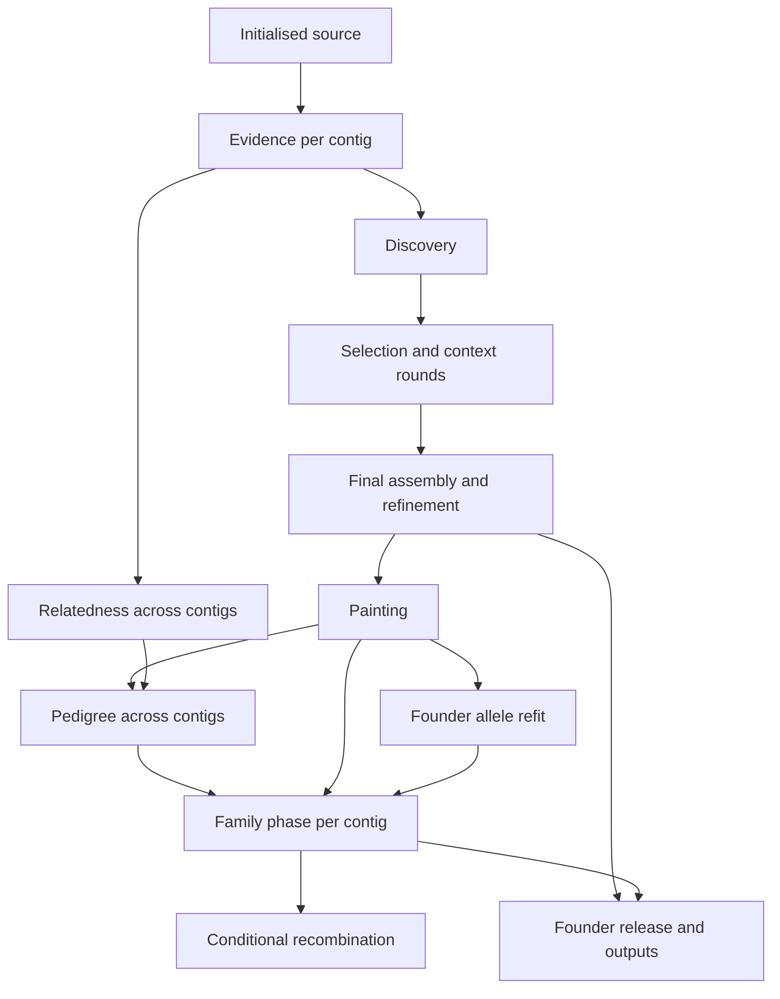

# Architecture

Science computes deterministic transitions over typed records. Stages construct
inputs, declare tasks and publish products. The engine schedules those tasks;
results readers expose checked products to exports, reports and evaluation.

## Layers

| Package | Responsibility | Dependencies |
|---|---|---|
| `core` | Numerics, ties, named streams, errors, digests, kernel declarations | Standard library and numerical primitives |
| `contracts` | Domain records, axes, units, roles, schemas, source protocols | Core and science parameter declarations |
| `store` | Containers, codec, checked readers, identities, publication | Core |
| `science` | Models, searches and shared scientific primitives | Core, contracts, declared scientific APIs |
| `engine` | Generic task execution, workers, runtime policy and run records | Core, store; generic contract validation where declared |
| `stages` | Task graph, production factories, input construction, records and science calls | Lower layers, the generic product-input protocol, explicit simulation input and export formatting routes |
| `results` | Checked product-input protocol and typed readers for complete or partial runs | Core, contracts, store, stage metadata and decoder-only record modules |
| `outputs` | Exports and report formatting | Core, contracts, results and the engine task protocol |
| `simulation` | Generating design, meiosis, reads and separate truth | Core, contracts |
| `evaluation` | Metrics against recorded simulation truth | Core, contracts, results, simulation truth types |
| `interface` | CLI, settings, API, status and tools | Public interfaces of the other packages |

The package root resolves its public API lazily through `interface`. Its private
`_version` module contains only the release label and is also loaded lazily by
the root. Scientific layers cannot import that module.

The repository's layer tests (the unit-test tier) enforce the exact allowed edges.
Results may import stage record decoders, including the explicitly separated
`*_records` modules, and the data-only stage table, but not publication or source-reading orchestration.
`results/protocol.py` supplies the shared identity/schema receipt and knows no stages or science.
Scientific stage actions use that input protocol and open a separate writable store capability.
The export stage may call the full read-only results facade and output formatters; inference never consumes exports. Output
formatters receive `FounderRelease`, `ReleasedSites`, `PedigreeViews` and other
contracts; they never reach into assembly to reconstruct a missing view.

Cross-science calls use small declared APIs: selection uses discovery fitting and
assembly context functions; pedigree and phase use painting emissions and state
probabilities. The finite selection/context rounds are explicit graph nodes.
Other stage connections carry records, not private implementation imports.
Science owns frozen `*Parameters` records and their defaults. Contracts and other
science areas may reference those same value types through exact parameter modules;
parameter declarations do not depend on contracts. A product captures a parameter
record directly, and its codec reconstructs the same type without a mirror record.

## Stage ownership

`stages/catalog.py` is the single data table for task modules, record owners, workflow
membership, kernel owners, status prefixes and published evaluation labels. Each stage's
task module contains its production factory. The interface binds those factories to a
selected graph cut; input construction and publication stay inside the stage's code identity.
Selection and assembly share identity-bound worker inputs in `stages/inputs/chain.py`.
The catalog's numerical roots and scopes define compile prerequisites separately from
full task identity/preload closures. Importing input builders, record readers or parameter
types therefore does not make a stage wait for unrelated scientific kernels to compile.

Each record owner supplies `expected(...)`, used by the producer and result reader.
The generic results protocol checks receipts once without decoding large arrays. Cut
prerequisites, stage presence, output dependencies and record-size queries reuse it.
Painting's stage owns component progress records, fixed sample blocks, resume merging
and emission-cache accounting. Painting science fits models and computes batch paths,
posteriors and release rules without checkpoint keys or publication callbacks.

Internal stage names are `selection`, `refit`, `phase`, `sites` and `release`.
Some durable spellings serve a different public serialization role and must remain:

| Stage | Preserved published spelling | Reason |
|---|---|---|
| `selection` | `local_selection`, `local_selection_<round>` | Manifest parameter section, context record paths and evaluation filenames |
| `refit` | `founder_refit` | Manifest section, stored record keys and evaluation filenames |
| `phase` | `family_phase` | Manifest section and evaluation/report filenames; the stored phase key is `phase` |
| `sites` | `ReleasedSites` | Typed product contract; the record key and reader method are `sites` |
| `release` | `FounderRelease` | Typed product contract; the record key and reader method are `release` |

These public spellings do not introduce alternate stage routes or alternate-name probes.
Code-identity closures include input construction, stage records, engine and store code;
structural changes therefore require fresh compatible checkpoints.

## Model graph

Evidence and maps are additional inputs where the stage contract names them.
Relatedness can run as soon as all evidence exists; reconstruction does not wait
for it. Pedigree consumes frozen painting, not refit feedback. Phase and maps never
feed upstream. [Workflow cuts](../user/workflow.md) expose the same dependencies.

## Tasks and resources

A task declares its key, input/output records, importable action, resource model
and optional contig affinity. An expansion returns independent subtasks and a
gather operation under the same resource authority. Results are placed by key;
completion order does not determine array or report order.

Phase chromosomes start in decreasing estimated size: sample count times retained
site count when evidence is present, initial simulation site count before evidence,
and declared VCF contig length when no retained site axis exists. These hints
change dispatch priority only. Recombination, export and report tasks read published
products without inheriting a chromosome worker's affinity. Recombination and
export may overlap once that chromosome's phase is complete; they do not wait for
another chromosome's phase. Tie collectors consume only their own painting chain.
Export manifest checks and founder identity collection run per chromosome, then
publish in configured order. Independent export files and pedigree report tables
use the same live CPU authority as their enclosing tasks; each writer owns a
separate destination and keeps its rows and cells in their established order.

The runtime bounds all teams by the verified core budget. It admits outer work
from measured memory pressure; predicted working-set sizes are diagnostics, not
reserved peaks. A task waiting for its children is suspended, while retained
contig state has a resident token. Resources are released on success, cancellation
and failure. A worker with live retained state cannot be recycled.

Science sees explicit teams and stage-owned array/window access. It does not read
the environment, files, clocks, logs or available memory. Resident/windowed and
dense/checkpointed routes use the same arithmetic and are tested against each
other. Scientific retry schedules, candidate caps and work accounts remain fixed
parameters even when their names include bytes.

Run records retain per-stage task resource aggregates; detailed task rows remain
in their append-only JSONL files. The scheduler observes its existing counters
for ten-minute progress and stage completion lines. Small stage diagnostic
messages travel in the worker's ordinary reply and are printed by the
coordinator, so forkserver workers need no separate log writer. Task replies also
carry checkpoint lock-wait and fsync seconds; the run recorder aggregates them and
warns once per contig when recent tasks spend most of their wall time waiting to
publish.

Status can prime its process-local header indexes from disposable container
snapshots saved at checked stage publication. The immutable container identity
and committed prefix length bind each snapshot; later appends are scanned by the
ordinary container reader. Missing or unusable caches require a normal header
scan. Scientific readers derive and check expected publication identities;
these operational caches and progress counts never enter those identities.

## Identities and publication

A derivation binds source payload content, upstream identities, explicit
parameters, tie settings, relevant code closure, adapters/codec and numerical
policy. Execution resources and output destinations are operational. Source
provenance can include a path or timestamp, but changing only a timestamp does not
change consumed evidence. A changed payload or incompatible derivation refuses
reuse. The release label stays outside scientific dependency closures, while
the full source digest retains it for provenance. A separate checkpoint layout
marker identifies release 4.12: readers and resumers refuse other releases
before reading scientific products. Invocation records and export manifests and
headers carry the same release label. The format-1 kernel manifest and standalone
payload-file codecs remain published interfaces. Check the current configuration
and checkpoint contracts before changing code on an existing run.

The append-only store commits each product atomically. Its envelope separates
scientific products from replaceable output snapshots. Scatter processes write
only their own contig container; init and gather own the run container. Markers
are written last and aid external scheduling; checked products remain the
completion authority. A copied completed root retains all bindings.

Checkpoint appends retain container format 1 and its ordered durability rule:
the writer fsyncs payload/trailer before writing the validating header, all under
the process append lock and cross-node file lock. The final fsync runs after
releasing those locks. A process-local sync lock groups complete headers, using
a prefix captured before fsync starts; every publisher, including a duplicate,
waits for a successful sync covering its header before returning. Separate
processes sync independently while later appends proceed. One payload fsync per
record remains serialized. Readers still index only complete headers/trailers,
without scanning payloads, and recovery still refuses unrecognised corruption.

## Runtime environment

The complete generated list of actual reads is in the
[environment reference](../reference/environment.md#environment-reads), including
indirect execution-scope variables and the `NUMBA_*` cache-key family. Science has
no environment reads. The runtime fixes numerical-library policy before imports,
then passes explicit tie settings and streams into tasks. Stage adapters supply
assembly workspaces and phase mapped scratch through their array interfaces.
The docs build fails if a new read is undocumented or occurs outside the runtime (`engine`).

See [contracts](contracts.md), [execution methods](../methods/execution.md),
[kernel declarations](kernels.md) and [testing](testing.md) for the executable checks.
